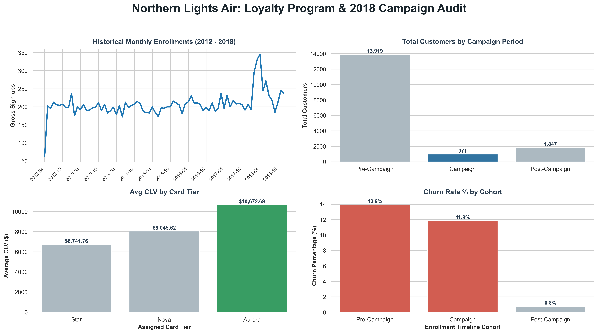
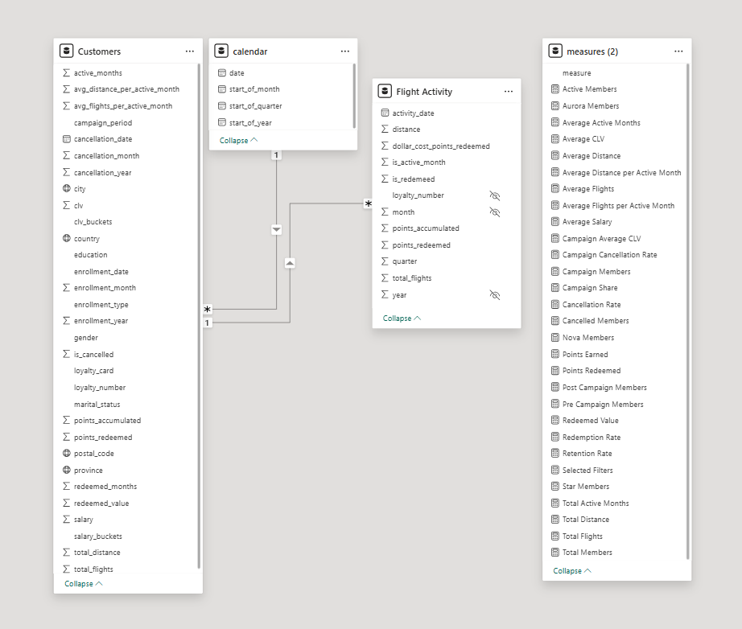

# Customer Loyalty Program Analysis: Northern Lights Air (NLA)

## 1. Project Overview & Business Aim
Northern Lights Air (NLA) is a Canadian airline that ran a special marketing promotion between February and April 2018 to get more people to sign up for its loyalty program. 

The main goal of this project is to see if that campaign actually worked. To do this, I analyzed historical signup patterns, checked the results of the 2018 promotion, looked at customer behavior across different demographics, and found specific groups of customers that the marketing team should focus on next.

---

## 2. Core Business Questions Targeted
This analysis was built to answer these key business questions:
* **Campaign Impact:** Did the 2018 promotion actually bring in a lot of new members?
* **Customer Quality:** Did the customers who signed up during the promotion stay with the airline, or did they cancel their memberships quickly?
* **Tier System Check:** Do the different loyalty card tiers (Star, Nova, Aurora) make sense based on how much those customers earn and their lifetime value?
* **Hidden Risks:** Are there groups of customers who are inactive or saving up too many points without using them?

---

## 3. Technical Approach & Data Architecture
I handled the entire data project using three main steps:

1. **Data Cleaning & Preparation (Python):** Used Python to fix data quality issues, like finding and removing duplicate rows in the massive flight activity data.
   * Fixed missing values, such as empty spaces in the customer salary column.
   * Combined different data tables together to create one clean master file (`final_customer_data.csv`).
2. **Database Analysis (SQL):**
   * Loaded the clean data into a database to write queries.
   * Wrote SQL queries to calculate customer groups, signup trends by month, and cancellation rates.
3. **Data Visualization (Power BI)**
   * Built a 2-page interactive Power BI dashboard to present key business insights through executive-level reporting. 
   * The dashboard features dynamic KPI cards, campaign performance analysis, enrollment trends, customer segmentation, loyalty tier analysis, CLV insights, and geographic member distribution. 
   * Interactive slicers and custom DAX measures enable stakeholders to explore loyalty program performance and evaluate the effectiveness of the 2018 marketing campaign.

---

#### Power BI Dashboard Demo:

## 4. Key Findings

report file document --> [Report (pdf)](./report.pdf)

### A. Monthly Signups & Campaign Results
* **Signup Spike:** The airline successfully signed up **971 new members** during the 3 months of the campaign, creating a huge visible spike compared to regular months.
* **Delayed Success:** The campaign also helped create brand awareness, leading to another **1,847 signups** right after the promotion ended.

### B. Customer Loyalty & Cancellation Rates
* **Overall observed cancellation:** Campaign-period customers had an observed cancellation rate of **11.84%**, compared with **13.92%** for pre-campaign customers. Because cohorts have different observation periods, this comparison should be interpreted alongside the fixed-horizon cohort analysis above.

### Cohort Retention Analysis

Overall cancellation rates can be misleading because older customers have had more time to cancel. To make the comparison fairer, retention was measured at fixed intervals after enrollment.

Only customers with sufficient observation time were included for each retention horizon.

| Cohort | 3-month eligible | 3-month retention | 6-month eligible | 6-month retention | 12-month eligible | 12-month retention |
|---|---:|---:|---:|---:|---:|---:|
| Pre-Campaign | 13,919 | 99.52% | 13,919 | 98.99% | 13,727 | 91.23% |
| Campaign | 971 | 99.38% | 971 | 99.07% | 0 | N/A |
| Post-Campaign | 1,363 | 99.78% | 747 | 98.80% | 0 | N/A |

### Interpretation

- Campaign-period customers showed strong short-term retention: **99.38% after 3 months** and **99.07% after 6 months**.
- Their short-term retention was broadly comparable to the pre-campaign cohort.
- A 12-month campaign retention rate could not be calculated because the campaign cohort did not have a full 12-month observation period.
- These results show that the campaign was not associated with unusually high early cancellations, but they do not prove that the campaign caused better retention.

### C. Loyalty Card Tier Inversion
* **Tier Misalignment:** The data revealed a unexpected tier-value mismatch with the card tiers. Customers in the "Star" tier actually have the lowest average salary and the lowest average Customer Lifetime Value (CLV) at **$6,741.76**.
* **Top Performers:** The "Aurora" tier is by far the most valuable group, bringing in an average CLV of **$10,672.69**. 

---

## 5. Extracted Customer Segments for Marketing

Using SQL queries, I isolated two specific groups of active customers that the airline should focus on:

1. **High-Flight, Zero-Redemptions (668 Customers):** These are members who fly a lot (above the 75th percentile) but have never used any points. This is a financial risk because the airline owes them a massive backlog of free rewards.
2. **Active but Dormant Accounts (619 Customers):** These are accounts that are officially still open, but the customers have recorded 0 flights and 0 active months. They are completely disengaged.

---

---

## 5. Data-Driven Recommendations

* **Push Point Redemptions:** Send a targeted email to the 668 active non-redeemers offering easy ways to spend their points (like one-click seat upgrades) to clear that points backlog off the airline's books.
* **Regional Sprints for Inactive Members:** Target the 619 dormant accounts with local flight deals, focusing on big areas like Ontario and British Columbia to get them flying again.
* **Fix Card Tier Rules:** Adjust the entry requirements for Star, Nova, and Aurora tiers so that a customer's status matches up linearly with their actual spending and income.
* **Keep Testing Short Promotions:** Run similar signup promotions with a controlled holdout group, since the 2018 campaign generated 971 members with strong observed short-term retention, while acknowledging that the analysis does not prove causal lift.
  
## Illustrative Business Impact Scenario

This is a scenario estimate, not a causal campaign result. The analysis surfaced **619 active-but-dormant members** and **668 high-flight members with no point redemptions**. Re-engaging 10% of dormant members would create approximately **62 reactivation candidates**, while converting 15% of high-flight non-redeemers to a redemption journey would create approximately **100 targeted members**. These targets should be evaluated with response, incremental flight, redemption, and margin data.

---

## 6. Tools used:
- Python (pandas, numpy, seaborn, matplotlib)
- PostgreSQL
- SQL Query Concepts Used:
- **Aggregate Functions:** Used `COUNT()`, `SUM()`, and `AVG()` to calculate customer counts, cancellation rates, average CLV, flight activity, points behavior, and campaign performance.
- **GROUP BY:** Segmented customers by campaign period, loyalty card tier, province, CLV bucket, salary bucket, enrollment type, and cancellation status.
- **Conditional Aggregation:** Used `CASE WHEN` inside aggregate functions to calculate inactive customer counts and inactivity rates.
- **Common Table Expressions (CTEs):** Used `WITH` clauses to structure monthly enrollment, cancellation, net growth, and percentile-threshold logic.
- **Date Functions:** Used `date_trunc()` and `make_date()` to analyze monthly enrollment, cancellation, and customer activity trends.
- **FULL OUTER JOIN:** Combined enrollment and cancellation timelines to calculate monthly net customer growth.
- **COALESCE:** Replaced missing enrollment or cancellation counts with zero during net growth calculations.
- **Percentile Analysis:** Used `percentile_cont()` to identify high-flight customers above the 75th percentile.
- **Customer Segmentation:** Created targeted groups such as high-flight zero-redemption customers, dormant active accounts, and low-engagement promotional customers.
- **Data Validation Queries:** Checked row counts, distinct customer counts, cancellation distribution, campaign-period counts, loyalty-tier distribution, date ranges, and inactive customer records.
  
---

## 7. Future Analysis:
Incorporate additional behavioral variables such as flight routes, booking frequency, and redemption patterns to build predictive churn and customer value models.

---

## 7. Power BI Data Modelling:

Power BI Data Model: Built using a star-schema-inspired design with separate Customer, Flight Activity, Calendar, and Measures tables to support scalable DAX calculations and interactive reporting.

#### Pavni Rastogi

---
